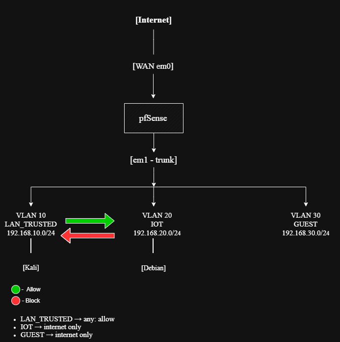

# pfSense Home Lab: VLAN Segmentation

Home lab project: a pfSense firewall configured from scratch with VLAN-based network segmentation, firewall rule design based on least privilege, and documented isolation testing.

## Goal
Segment a network into three isolated VLANs (trusted, IoT, guest) to limit lateral movement, and verify with real traffic tests that the firewall rules do what they are supposed to do.

## Environment
- pfSense CE 2.8.1 running in VirtualBox
- WAN: NAT Network (em0)
- LAN / trunk: Internal Network "LabNet" (em1), carrying 802.1Q tagged VLANs
- Test VMs: Kali Linux (VLAN 10) and Debian (VLAN 20)

## Network Design

| VLAN | Interface   | Subnet           | Policy                                      |
|------|-------------|------------------|---------------------------------------------|
| 10   | LAN_TRUSTED | 192.168.10.0/24  | Full access, including to other VLANs       |
| 20   | IOT         | 192.168.20.0/24  | Internet only, blocked from VLAN 10 and 30  |
| 30   | GUEST       | 192.168.30.0/24  | Internet only, blocked from VLAN 10 and 20  |

Each VLAN has its own DHCP scope (.100 to .200). Block rules sit above the "allow to internet" rule, because pfSense evaluates rules top-down and the first match wins.

## Results
- LAN_TRUSTED to IOT: allowed (0% packet loss)
- IOT to LAN_TRUSTED: blocked (100% packet loss), confirmed in the firewall log by the custom rule "Block IOT to LAN_TRUSTED"

Details and screenshots: [docs/testing.md](docs/testing.md)

## Troubleshooting highlight
In the first test both directions were blocked, and the firewall log showed the traffic on interface LAN instead of IOT. Root cause: the test VMs kept their original untagged default route, which competed with the VLAN route. Removing the stale route fixed it. The full write-up is in the testing doc.

## Limitations
- VirtualBox cannot tag 802.1Q at the virtual switch, so VLAN tags were applied inside the guest OS (ip link add ... type vlan). In a real office this is done by a managed switch (access and trunk ports).
- GUEST rules are configured but were not tested separately, since their logic is identical to the IOT rules.
- IPv4 only.

## What's in this repo
- [docs/firewall-rules.md](docs/firewall-rules.md): every rule with its rationale
- [docs/testing.md](docs/testing.md): test method, results, troubleshooting
- docs/network-diagram.png: topology and policy diagram
- screenshots/: configuration and test evidence

## Skills demonstrated
VLAN design (802.1Q), firewall rule design (least privilege, rule ordering), DHCP per segment, firewall log analysis, root-cause troubleshooting, technical documentation.